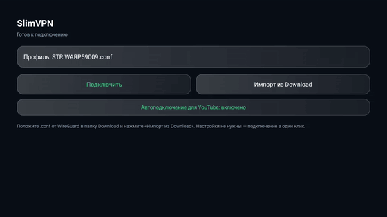
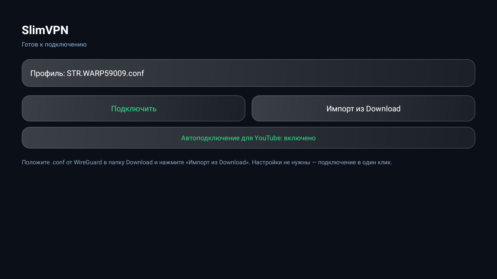
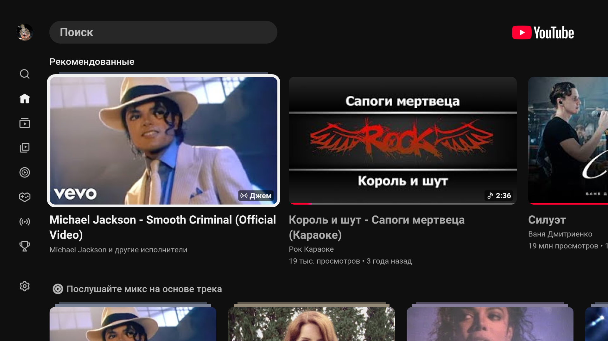
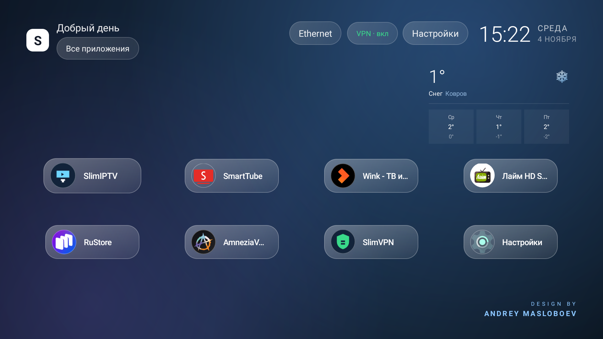

<div align="center">

# SlimVPN

**VPN-клиент для Android TV на движке AmneziaWG: обходит DPI, сам включается при запуске YouTube.**

[](LICENSE)
[](https://github.com/mosloboev444-hue/slimvpn/releases/latest)
[](https://developer.android.com/tv)
[](https://github.com/amnezia-vpn/amneziawg-android)

[](https://github.com/mosloboev444-hue/slimvpn/stargazers)
[](https://github.com/mosloboev444-hue/slimvpn/releases)

[Скачать APK](https://github.com/mosloboev444-hue/slimvpn/releases/latest) · [Другие проекты](#экосистема)

</div>



## Зачем AmneziaWG

Обычный WireGuard в российских сетях режется DPI: рукопожатие проходит, а данные — нет.
AmneziaWG добавляет обфускацию (`Jc`, `Jmin`, `Jmax`, `H1`–`H4`, подмена заголовков), и такой трафик проходит.
Конфиги AmneziaWG совместимы с WARP: `Endpoint = engage.cloudflareclient.com:4500`.

## Что умеет

| | |
|---|---|
| **Импорт `.conf`** | берёт первый профиль из `/sdcard/Download`, кнопка «Импорт из Download» — перечитать |
| **Одно нажатие** | подключение/отключение, статус и ошибки на экране |
| **Сторож YouTube** | раз в 2 секунды смотрит активное окно и поднимает VPN, когда на экране YouTube, а при выходе опускает |
| **Не мешает вручную** | выключает только тот туннель, который поднял сам |
| **Автозапуск** | сторож стартует после загрузки приставки |
| **Разрешения по запросу** | переключатель «Автоподключение для YouTube» прямо на главном экране |

## Скриншоты

| SlimVPN | YouTube через VPN | Кнопка на рабочем столе |
|---|---|---|
|  |  |  |

## Установка

```bash
adb install -r SlimVPN-2.1.apk
adb push my.conf /sdcard/Download/my.conf

# разрешения для сторожа (на ТВ выдаются только через adb/root)
adb shell appops set com.slimvpn.app GET_USAGE_STATS allow
adb shell appops set com.slimvpn.app ACTIVATE_VPN allow
```

Дальше: открыть SlimVPN → «Импорт из Download» → «Подключить».

## Как устроено

```
app/src/main/java/com/slimvpn/app/
  MainActivity.java     — экран: профиль, подключение, автоподключение
  VpnController.java    — единая точка управления туннелем
  AutoVpnService.java   — foreground-сторож: UsageStats → вкл/выкл VPN
  BootReceiver.java     — запуск сторожа после загрузки
  org/amnezia/awg/**    — Java-часть AmneziaWG (Apache-2.0)
app/src/main/jniLibs/armeabi-v7a/libwg-go.so — Go-ядро AmneziaWG (android/arm)
```

## Сборка Go-ядра

`libwg-go.so` уже лежит в `jniLibs`, но его можно пересобрать:

```powershell
tools/build-libwg-go.ps1 -GoPath C:\go\bin\go.exe -Ndk C:\android-sdk\ndk\27.2.12479018
```

Скрипт делает то же, что Makefile из `amneziawg-android`, но без POSIX-утилит (`flock`, `sha256sum`, `tar`),
поэтому работает на Windows.

## Экосистема

| проект | что это |
|---|---|
| [SlimHome](https://github.com/mosloboev444-hue/slimhome) | лаунчер: стеклянная сетка, погода, кнопка VPN |
| [SlimIPTV](https://github.com/mosloboev444-hue/slimiptv) | IPTV-плеер: 1252 канала, автообновление плейлиста |
| **SlimVPN** | этот клиент |

## Лицензия

Код приложения — MIT (см. [LICENSE](LICENSE)). Java- и Go-часть AmneziaWG — Apache-2.0,
см. [LICENSE-AMNEZIAWG.txt](LICENSE-AMNEZIAWG.txt).

**Важно:** репозиторий не содержит конфигов и ключей. Свой конфиг вы получаете у провайдера VPN
или генерируете сами (например, WARP через `wgcf`).